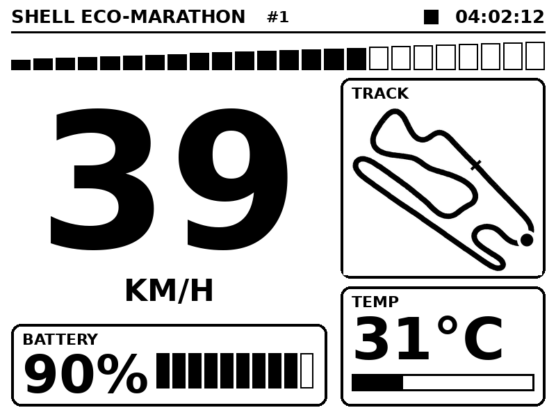
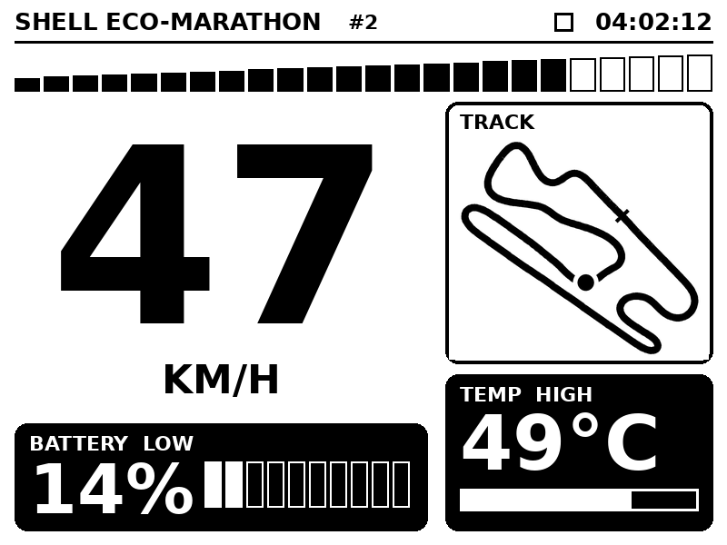

# Dashboard-E-ink

A car dashboard on an old **Kindle 4 (non-touch)** e-ink screen. A small Python server draws the dashboard as an image, and the Kindle downloads it over Wi-Fi in a loop and shows it on the e-ink display.

Built for a Shell Eco-marathon car: speed, battery, temperature and position on a track map, readable in sunlight, with no extra display hardware.

> **Status: work in progress.** The server still generates **fake data** for speed, battery, temperature and car position, so the layout can be tested. The **track map now shows the real Silesia Ring outline** from `track.json`. Real data will come from ROS 2 (see [Planned](#planned-real-data-from-ros-2)). Refresh rate is being optimised (goal: about 1 update per second).

## Preview

| Normal | Alerts (low battery, high temperature) |
|---|---|
|  |  |

- **Speed**: huge number plus a 24-segment rising bar
- **Battery**: percentage and 10 cells; the card inverts to white-on-black below 20 %
- **Temperature**: value and bar; the card inverts above 45 °C
- **Track map**: smooth outline of the race course (Silesia Ring, loaded from `track.json`), with a start/finish tick and a moving car dot
- **Top bar**: clock, frame counter and a heartbeat square that flips on every refresh, so you can see the real update rate

Black and white only, with thick strokes and big numbers, because e-ink has no colour and thin lines look bad.

## How it works

```
┌──────────────────────┐   HTTP (plain, no TLS)   ┌─────────────────────┐
│  server.py           │ ───────────────────────► │  Kindle 4           │
│  (laptop / Pi)       │   600x800 grayscale PNG  │  wget + eips loop   │
│  draws the dashboard │ ◄─────────────────────── │  draws it on e-ink  │
└──────────────────────┘      every refresh       └─────────────────────┘
```

1. `server.py` draws the dashboard in landscape (800x600), rotates it, and serves a **600x800, 8-bit grayscale PNG** at `/dash.png`.
2. A shell loop on the Kindle downloads the PNG with `wget` and draws it with `eips`, the Kindle's own framebuffer tool.
3. Every N frames it does a full-flash refresh to clear e-ink ghosting; in between it uses fast partial updates.

## Requirements

**Server (laptop or Raspberry Pi)**
- Python 3
- Pillow: `pip install pillow`
- Fonts: Bahnschrift or Arial Bold on Windows, DejaVu Sans Bold on Linux (falls back automatically)

**Kindle**
- Kindle 4 non-touch, **jailbroken**, with **USBNetwork** so you can SSH in
  - Jailbreak and USBNetwork instructions: see the MobileRead threads linked in [Credits](#credits)
  - The root password depends on the firmware; the USBNetwork thread explains how it is derived
- Connected to the same Wi-Fi network as the server (the Kindle 4 only supports **2.4 GHz**)

## Setup

### 1. Run the server

```bash
pip install pillow
python server.py
```

Check it in a browser at `http://localhost:8000/`. You should see the dashboard (rotated, because it is drawn for the Kindle's portrait screen).

Find the server's IP (`ipconfig` on Windows, `hostname -I` on Linux). The Kindle needs it. On Windows, allow the port through the firewall if the Kindle can't connect:

```powershell
New-NetFirewallRule -DisplayName "Kindle dash" -Direction Inbound -Protocol TCP -LocalPort 8000 -Action Allow
```

### 2. Test the Kindle connection

SSH into the Kindle (`ssh root@<KINDLE_IP>`) and run:

```sh
wget -O /tmp/t.png http://<SERVER_IP>:8000/dash.png && ls -l /tmp/t.png
eips -c
eips -g /tmp/t.png
```

If the image shows on the screen, the whole chain works.

### 3. Create the display loop on the Kindle

Replace `<SERVER_IP>`, then paste this on the Kindle:

```sh
cat > /mnt/us/fast.sh <<'EOF'
#!/bin/sh
SERVER="http://<SERVER_IP>:8000/dash.png"
FULL_FLASH_EVERY=30

/etc/init.d/framework stop >/dev/null 2>&1
lipc-set-prop com.lab126.powerd preventScreenSaver 1
IMG=/tmp/dash.png
N=0
while true; do
  if wget -q -O $IMG.new "$SERVER"; then
    mv $IMG.new $IMG
    N=$((N+1))
    if [ $((N % FULL_FLASH_EVERY)) -eq 0 ]; then
      eips -f -g $IMG      # full flash: clears ghosting
    else
      eips -g $IMG         # fast partial update
    fi
  else
    sleep 2                # server down: don't spin
  fi
done
EOF
```

`/mnt/us` is a FAT filesystem with no execute permission, so always start scripts with `sh`.

## Run

```sh
sh /mnt/us/fast.sh
```

The Kindle UI disappears and the dashboard starts updating. Turn the Kindle sideways to read it. If the picture is upside-down, change `ROTATE = 90` to `270` in `server.py` and restart the server.

**Stop and get the normal Kindle UI back:**

```sh
# Ctrl+C, then
/etc/init.d/framework start
```

To keep it running after you close the SSH session, use `nohup sh /mnt/us/fast.sh > /dev/null 2>&1 &`; stop it later with `kill <PID>` (find it with `ps | grep fast.sh`), then start the framework again.

## Configuration

| Setting | Where | Meaning |
|---|---|---|
| `ROTATE` | `server.py` | `90` or `270`, depending on how the Kindle is mounted |
| `PORT` | `server.py` | Port of the image server (default `8000`) |
| `fake_data()` | `server.py` | Source of speed, battery, temperature and track position; replace with real data |
| `TRACK_FILE` | `server.py` | Track outline file (default: `track.json` next to `server.py`). If it is missing, a placeholder oval is drawn |
| `MAP_BOX` | `server.py` | Area of the map card where the track is fitted (the track is scaled and centred automatically) |
| `SMOOTH` | `server.py` | Smoothing of the traced track, in points. `0` = off. Above about 5, tight hairpins start to shrink |
| `SS` | `server.py` | Track drawing size multiplier for smooth edges (default `4`). Lower it if the CPU is too slow |
| `SERVER` | `fast.sh` | URL of the image, with the server's IP |
| `FULL_FLASH_EVERY` | `fast.sh` | Full-flash refresh every N frames (ghosting vs. flicker) |

## Planned: real data from ROS 2

The dashboard will not use GPS directly. The car's position on the track comes from the ROS 2 code, and the track outline is a fixed drawing of the race course.

**Track outline** (done): `track.json` holds a list of points around the loop.
- The first point is the start/finish line, and the points follow the driving direction.
- The file in this repo was traced from the Silesia Ring layout image. The numbers are image pixels (y points down); `server.py` scales and centres them, so no real units are needed.
- The server smooths the points and draws them at a higher resolution, so the line looks clean even if the tracing is a bit shaky.
- To use another track, replace `track.json` with the same format:

```json
{"closed": true, "points": [[x0, y0], [x1, y1], ...]}
```

**Position topic**: `/track/progress` (`std_msgs/Float32`)
- Fraction of the lap completed since the start/finish line, from `0.0` to `1.0`, in the driving direction.
- Wraps from `1.0` back to `0.0` at the line.
- The server converts it into a point along the outline, by distance along the line, so the car moves at an even speed on the map. It never needs coordinates.

**Running on the Pi**: `server.py` will move to the Raspberry Pi, with a background thread (`rclpy`) that subscribes to the topics and keeps the latest values. If no message arrives for a couple of seconds, the dashboard shows dashes instead of stale numbers. Until then, test with a fake publisher:

```bash
ros2 topic pub /track/progress std_msgs/Float32 "{data: 0.25}"
```

## Troubleshooting

| Problem | Likely cause and fix |
|---|---|
| `wget` hangs or fails | Wrong server IP, server not running, or firewall blocking the port |
| Garbage, stripes or wrong picture | The PNG is not 600x800 8-bit grayscale (no alpha) |
| Image upside-down or sideways | Change `ROTATE` between `90` and `270`, or turn the Kindle |
| Ghosting (faint old frames) | Lower `FULL_FLASH_EVERY` |
| Scripts fail with odd errors | Windows line endings (CRLF). Convert to LF, or on the Kindle: `tr -d '\r' < f > f.tmp && cat f.tmp > f` |
| Kindle UI doesn't come back after stopping | Run `/etc/init.d/framework start`. If it keeps crashing, run `for s in volumd tmd phd cmd webreader; do /etc/init.d/$s start; done` then `/etc/init.d/framework restart`, or `reboot` |
| Can't SSH after reboot | On the Kindle, type `;un` in the search bar and press Enter to enable USBNetwork |
| BusyBox command not found / unknown option | The Kindle's BusyBox is old: no `od`, and `grep` has no `-E`. Keep scripts to simple POSIX shell |

## Roadmap

- [ ] Faster refresh (about 1 update per second): CPU governor, overlapping download and draw, partial updates with periodic full flash
- [ ] Real data instead of fake: speed, battery and temperature from the car (ROS 2 topics on a Raspberry Pi)
- [x] Track outline matching the race course (`track.json`), smoothed
- [ ] Car position on the map from a ROS 2 topic (`/track/progress`)
- [ ] Run the server on the Raspberry Pi in the car, on the car's own Wi-Fi hotspot
- [ ] Autostart the display loop on boot (kite / KUAL)
- [ ] Wi-Fi reconnect, low-battery screen and "no data" screen on the Kindle

## Limits of e-ink

A partial update takes roughly 0.3 to 0.5 s and a full flash about 1 s, so this suits numbers and gauges at around 1 to 2 Hz. It is not for fast animation.

## Credits

The Kindle-side approach (stopping the UI, fetching a PNG over plain HTTP, drawing it with `eips`) comes from these projects:

- [fbarresi/kindle-4-dashboard](https://github.com/fbarresi/kindle-4-dashboard) (Home Assistant dashboard on a Kindle 4), based on [sibbl/hass-lovelace-kindle-4](https://github.com/sibbl/hass-lovelace-kindle-4)
- [nicoh88/kindle-kt3_weatherdisplay_battery-optimized](https://github.com/nicoh88/kindle-kt3_weatherdisplay_battery-optimized)
- MobileRead: [Kindle 4 NT jailbreak](https://www.mobileread.com/forums/showthread.php?t=191158) and [USBNetwork](https://www.mobileread.com/forums/showthread.php?t=88004)

## License

Not chosen yet. Add a `LICENSE` file before sharing the code more widely.
